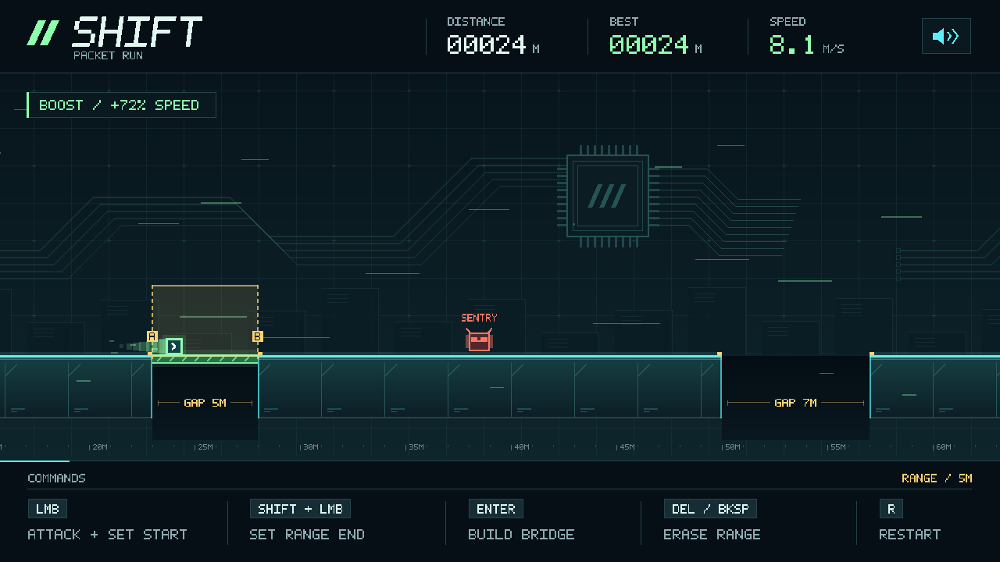

# SHIFT // Packet Run

A 2D auto-runner for GitHub Game Off 2026. You are a packet moving through a live system. Edit the track before the packet reaches it. Distance is your score. A collision or a fall instantly boots a new run.



## Play

Use a desktop browser with a mouse and keyboard. Click **Run Program** or press **Enter** to start. The packet always moves right.

| Input | Effect |
| --- | --- |
| Left-click the course | Attack directly ahead of the packet and mark the start of a range at the pointer. |
| Shift + left-click | Mark the other end. You can select in either direction and adjust this endpoint while running. |
| Enter | Compile a walkable code bridge across the highlighted range. |
| Delete or Backspace | Erase the selected bridge sections, firewalls, sentries and hazards. To cut the foundation as well, place either marker inside the floor, at least half a metre below the surface. |
| R | Restart immediately. |
| Speaker button | Toggle the synthesized sound effects. |

**Try the first gap.** Click its left lip, Shift-click its right lip, then press Enter. The lips snap your markers into place. An exact fit gives a 72% speed boost with speed lines and a kick of camera shake. A bridge 1.5 times the gap width gives 36%. At twice the gap width the speed reward reaches zero. Bridge length is unrestricted.

The first gap is always 5 m wide. New runs vary the course beyond the opening. As you travel, the packet gets faster, gaps get wider and obstacles become more frequent. The best distance is saved in the current browser.

## Run and build in Unity

1. Open this repository in **Unity 6000.3.7f1** with **Web Build Support** installed.
2. Open **Assets/Scenes/PacketRun.unity** and press **Play**. The runtime creates the camera, track, HUD and audio when the scene starts.
3. Select **SHIFT → Build WebGL**. The editor writes the browser player to `Builds/WebGL/` and its upload archive to `Builds/SHIFT-Packet-Run-WebGL.zip`.

The same build is available from the command line. Run from the project root with the editor closed, using your Unity executable in place of `Unity`.

```sh
Unity -batchmode -nographics -quit -projectPath . -buildTarget WebGL -executeMethod ShiftRunner.Editor.WebBuild.Build -logFile build.log
```

For a local browser preview, serve the exported directory over HTTP.

```sh
python -m http.server 8000 --bind 127.0.0.1 --directory Builds/WebGL
```

Open [the local player](http://127.0.0.1:8000/). The WebGL template uses relative asset URLs and works inside an itch.io embed.

## itch.io submission

Create an **HTML** game, upload `SHIFT-Packet-Run-WebGL.zip`, and enable **This file will be played in the browser**. Use a **960 × 540** embed with the fullscreen button enabled. Publish the game page, then submit it through the jam page by **December 1, 2026 at 1:37 p.m. Pacific**. [itch.io HTML upload guide](https://itch.io/docs/creators/html5) · [Game Off 2026](https://itch.io/jam/game-off-2026)

- **Source repository** — [github.com/pupupurin3/shift-packet-run](https://github.com/pupupurin3/shift-packet-run)
- **Theme interpretation** — Shift-click extends a file-explorer-style selection across live terrain. Compile the range into a bridge or delete the selected code.
- **AI disclosure** — OpenAI Codex assisted with the C# implementation, procedural graphics and sound code, build setup, and testing. The game draws its geometric artwork and synthesizes its effects at runtime.

## Source guide

| Path | Responsibility |
| --- | --- |
| `Assets/Scripts/Core/RunnerGame.cs` | Fixed-step motion, collision, attack, scoring, boost and restart. |
| `Assets/Scripts/Core/RunnerWorld.cs` | Seeded generation, difficulty progression, streaming and gap geometry. |
| `Assets/Scripts/Core/RangeSelection.cs`, `PlatformEditor.cs` | Selection state, snapping integration, clipped edits and bridge efficiency. |
| `Assets/Scripts/Unity/` | Input, camera projection, procedural drawing, HUD, audio and best-score storage. |
| `Assets/Editor/WebBuild.cs` | Unity WebGL export and itch.io ZIP packaging. |
